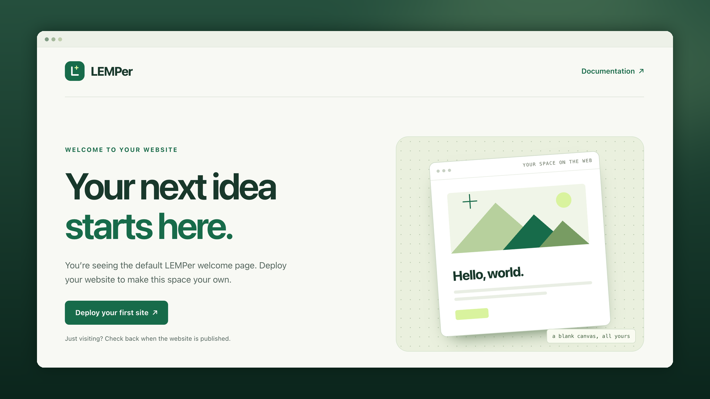

# [L]inux [E]ngine-X [M]ariaDB [P]HP Install[er]

<p align="center">
  
</p>

<p align="center">
<a href="https://github.com/joglomedia/LEMPer/releases"></a>
<a href="https://github.com/joglomedia/LEMPer/stargazers"></a>
<a href="https://github.com/joglomedia/LEMPer/network"></a>
<a href="https://github.com/joglomedia/LEMPer/issues"></a>
<a href="https://github.com/joglomedia/LEMPer/actions/workflows/main.yml"></a>
<a href="https://raw.githubusercontent.com/joglomedia/LEMPer/master/LICENSE.md"></a>
</p>

LEMPer is a Bash installer and administration tool for LEMP stacks on Debian
and Ubuntu. It manages Nginx, PHP, databases, websites and optional hosting services.

## Features

| Feature | Guide |
|---|---|
| Nginx packages/source builds, caching, HTTP/2 and optional HTTP/3 | [Web server features](docs/FEATURES.md#nginx) |
| PHP 8.2–8.5 with isolated per-user FPM pools | [PHP features](docs/FEATURES.md#php) and [runtime defaults](docs/PHP_RUNTIME_LARAVEL.md) |
| Application skeletons, latest release deployment and licensed manual sites | [Application capabilities](docs/APPLICATIONS.md) |
| SQL/NoSQL, Redis/Valkey, Memcached, Bun.js and FTP | [Stack services](docs/FEATURES.md#optional-services) |
| Multi-domain SMTP/IMAP hosting, accounts and DKIM | [Mail](docs/MAIL.md) |
| TLS, Fail2ban, CrowdSec, ModSecurity and firewall recovery | [Security](docs/FEATURES.md#security) and [firewall](docs/FIREWALL.md) |
| Configuration, SQL and encrypted application/mail backups | [Backups and recovery](docs/MAINTENANCE.md#backups) |
| Hosting quotas and Monit health checks | [Hosting](docs/HOSTING.md) and [monitoring](docs/MONITORING.md) |
| CLI, interactive TUI and optional web panels | [CLI](docs/CLI.md) and [web administration](docs/FEATURES.md#web-administration) |

## Quick start

Use a fresh server with root/sudo access, Bash 5+ and working APT access.
Supported systems are Debian 11/12 and Ubuntu 22.04/24.04/26.04 on amd64/arm64;
Linux Mint 21–22 retains its Ubuntu-base support. See
[installation requirements](docs/INSTALLATION.md#requirements) and
[Ubuntu 26.04 notes](docs/UBUNTU_26_04.md).

The commands below use the pinned **v4.0.0** release. See the
[installation guide](docs/INSTALLATION.md) for profiles and checkout installation.
Existing v3 servers need a backed-up migration plan; database/mail storage major
upgrades are separate from CLI updates.

Install only the CLI:

```bash
curl -fsSL https://github.com/joglomedia/LEMPer/releases/download/v4.0.0/get-lemper -o get-lemper && sudo bash get-lemper --version 4.0.0
```

For a fresh minimal stack, first prepare a private profile:

```bash
curl -fsSL https://raw.githubusercontent.com/joglomedia/LEMPer/v4.0.0/.env.dist -o lemper.env
chmod 0600 lemper.env
${EDITOR:-vi} lemper.env
```

Set the hostname, IP, administrator email and SSH public key. On ARM64, set
`NGINX_INSTALLER="source"`. See the [profile instructions](docs/INSTALLATION.md#install-from-a-release).
Then install Nginx, PHP, MariaDB, Certbot, Fail2ban and CLI tools:

```bash
curl -fsSL https://github.com/joglomedia/LEMPer/releases/download/v4.0.0/get-lemper -o get-lemper && sudo bash get-lemper --version 4.0.0 --install --config ./lemper.env --minimal --yes
```

Add `--dry-run` to inspect the plan; omit `--minimal` for the services selected
in your profile. For existing servers, follow [updates and backups](docs/MAINTENANCE.md).

## Common commands

```bash
sudo lemperctl account webowner
sudo lemperctl site create example.com --type=wordpress --runtime=php@8.5 \
  --runtime-user=webowner --install-skeleton
sudo lemperctl stack status nginx
sudo lemperctl tui
lemperctl --help
```

`lemper-cli` remains a compatibility alias. See the [CLI guide](docs/CLI.md) for
site/service management, credentials, removal and benchmarks, and the
[application guide](docs/APPLICATIONS.md) for supported deployment types.

## Documentation and development

Browse the [documentation index](docs/README.md), [developer guide](DEVELOPER.md),
[changelog](CHANGELOG.md) and [roadmap status](docs/ROADMAP_AUDIT.md).
[Release preparation](docs/RELEASE_V4.md) and [UAT results](docs/UAT_REPORT.md)
record validation and release limits.
Download the SVG [logos and icons](docs/BRAND.md) for project presentations.

Contributions are welcome; see [CONTRIBUTING.md](CONTRIBUTING.md).
Report bugs and request features through [GitHub issues](https://github.com/joglomedia/LEMPer/issues).

## People and license

Maintained by [Edi Septriyanto (@joglomedia)](https://github.com/joglomedia) with
[our contributors](https://github.com/joglomedia/LEMPer/graphs/contributors).
Support development through [PayPal](https://paypal.me/masedi).

Licensed under [GNU GPLv3](LICENSE.md). Copyright © 2014–2026
[MasEDI.Net](https://masedi.net/).
